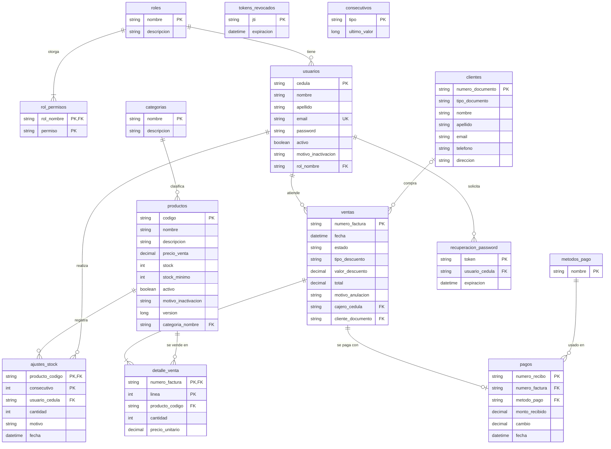

# Modelo de datos

Diagrama entidad-relación del sistema POS. Es el diseño de referencia: las migraciones SQL y las entidades JPA se derivan de él. Todas las llaves primarias son datos propios de la entidad (ninguna autogenerada), como pidió el profesor.

Estado: Sprints 1 y 2 implementados (migraciones `V1`, `V2` y `V3` de Flyway); Sprints 3 a 5 son proyección. Cambios respecto al diseño aprobado: `productos.motivo_inactivacion` y, en `clientes`, apellido opcional y nombre de 150 caracteres para la razón social de un NIT (ver las notas más abajo).

## Llaves y decisiones

| Tabla | Llave primaria | Sprint |
|---|---|---|
| `usuarios` | `cedula` | 1 |
| `roles` | `nombre` (mayúsculas) | 1 |
| `rol_permisos` | (`rol_nombre`, `permiso`) | 1 |
| `categorias` | `nombre` | 1 |
| `tokens_revocados` | `jti` | 1 |
| `productos` | `codigo` | 2 |
| `ajustes_stock` | (`producto_codigo`, `consecutivo`) | 2 |
| `clientes` | `numero_documento` | 2 |
| `metodos_pago` | `nombre` | 3 |
| `consecutivos` | `tipo` | 3 |
| `ventas` | `numero_factura` | 3 |
| `detalle_venta` | (`numero_factura`, `linea`) | 3 |
| `pagos` | `numero_recibo` | 4 |
| `recuperacion_password` | `token` | 5 |

- **`clientes`**: `numero_documento` es la llave; `tipo_documento` es una columna normal. Si el tipo es `NIT` (una empresa), `nombre` guarda la razón social y `apellido` queda vacío; para las personas el apellido es obligatorio (lo valida la aplicación). Ver los cambios al final.
- **`productos.codigo`** es un SKU numérico (de 4 a 14 dígitos, que cubre los códigos internos y los de barras EAN-8, EAN-13 y GTIN-14). Se guarda como texto (`VARCHAR`) para no perder los ceros a la izquierda; el formato lo valida la aplicación.
- **Números de factura y de recibo**: los genera la aplicación (por ejemplo `F-000001`) a partir de la tabla `consecutivos`, leyendo y aumentando el último valor dentro de una transacción con bloqueo, para que dos cajeros simultáneos no obtengan el mismo número. La base no usa autoincremental.
- **`ajustes_stock` y `detalle_venta`**: no tienen un dato propio que los identifique por sí solos, así que usan una llave compuesta con un consecutivo por producto (`consecutivo`) o por factura (`linea`).
- **`productos.stock`** guarda el stock actual; `version` evita que dos ajustes o ventas simultáneas se pisen (`@Version`). `ajustes_stock` es el historial de cada ajuste con su motivo. `productos.motivo_inactivacion` guarda el motivo que pide el RF-017 al inactivar (igual que en `usuarios`); se agregó al implementar el Sprint 2.
- **`ventas` 1 a 0..1 `pagos`**: una venta se paga una sola vez (no hay pagos parciales en los requisitos).
- **Factura y recibo** (RF-032, RF-035) no son tablas: son documentos generados a partir de `ventas` y `pagos`. Los reportes (RF-036 a RF-040) son consultas.

- **Método de pago**: `metodos_pago` es el catálogo de opciones que el cliente puede usar; `pagos.metodo_pago` guarda el que finalmente se eligió. La venta no guarda método de pago, para no tener el mismo dato en dos lugares. El texto del RF-025 menciona el método de pago como dato de la venta; se ajusta cuando se implemente el Sprint 3.
- **`ventas.estado`** toma tres valores: `EN_PROCESO`, `REGISTRADA` y `ANULADA`.

## Cambios respecto al diseño aprobado

- **`productos.motivo_inactivacion` (Sprint 2).** No estaba en el diagrama aprobado. El RF-017 pide un motivo al inactivar un producto, y sin esta columna el motivo se perdería. Se copió el criterio de `usuarios.motivo_inactivacion` (texto de hasta 500 caracteres, vacío mientras el producto está activo).
- **`ajustes_stock.motivo` y `usuario_cedula` son obligatorios** (`NOT NULL`): un ajuste sin responsable o sin motivo no sirve como historial (RF-019).
- **`clientes`:** el tipo de documento se valida en la aplicación (CC, CE, TI, NIT o PP) y no en la base de datos, para poder agregar tipos sin una migración.
- **`clientes.apellido` es opcional y `clientes.nombre` admite 150 caracteres (migración `V3`, 2026-10-12).** Una empresa (NIT) tiene razón social y no apellido, y la razón social se guarda en `nombre`. Con `V2` el apellido era obligatorio. La `V3` lo vuelve opcional y, para los NIT que ya existían con nombre y apellido (por ejemplo "Tienda" + "El Sol"), los une en una sola razón social ("Tienda El Sol").
- **`productos.codigo` pasó a SKU numérico (2026-10-12):** antes aceptaba cualquier texto de hasta 30 caracteres. Solo cambió la validación de la aplicación, no la columna, así que no hizo falta migración; los productos creados antes con letras siguen existiendo.

## Pendiente

- Los requisitos RF-001, RF-004 y RF-006 se actualizaron a "cédula" el 2026-10-11 (`docs/heredado-ds1/pos_requisitos_funcionales.xlsx` y su `.md`). El SRS (`SRS_Sistema_POS_completo`) y el documento de arquitectura entregado siguen con la redacción anterior (usuario por nombre de usuario, llaves autoincrementales, sin Flyway).
